# BMUX — Browser Multiplexer

<p align="center">
  <picture>
    <source media="(prefers-color-scheme: dark)" srcset="docs/images/bmux-logo-dark.png">
    
  </picture>
</p>

<p align="center">
  <a href="manifest.json"></a>
  <a href="LICENSE"></a>
  
  
  
  
</p>

<p align="center">
  <em>A Chrome extension (Manifest V3) inspired by TMUX that turns a browser tab into a
  terminal-style multiplexer — panes that never reload, layouts that survive, and a
  command line that can look inside the pages.</em>
</p>

## Why BMUX?

I've been a tmux user for a long time. Long enough that panes, windows, sessions,
keyboard-driven navigation and the general philosophy behind terminal multiplexing
have become second nature to me.

Over the years, I've spent a considerable amount of time experimenting with terminal
workflows, combining tools like tmux, fzf, reptyr and various TUI libraries to build an
environment that works the way I think. I've written about some of that exploration
here:

**[FZF Is An Absolute Command Line Powerhouse](https://www.dtrh.net/blog/2501/FZF-is-an-Absolute-Command-Line-Powerhouse)**

Eventually, I started thinking: why should that workflow be limited to the terminal?

The browser has become one of the most important tools in modern computing. We spend
enormous amounts of time researching, developing, debugging, managing projects and
working across dozens of tabs. Yet the traditional browser experience still feels
surprisingly disconnected from the workflows we've spent years refining in the terminal.

**BMUX is my attempt to change that.**

Inspired by tmux, BMUX brings a multiplexer-style workflow into the browser. Multiple
panes, persistent layouts, keyboard-driven interaction, windows, commands and the
ability to inspect and interact with pages without constantly switching between tabs.

This isn't intended to replace tmux, nor is it an attempt to turn the browser into
something it isn't. It's about taking a workflow I genuinely enjoy using and applying
its best ideas somewhere they make just as much sense.

I'm building BMUX because I want it to be something I'd actually use every day.
Something powerful, flexible and extensible, without sacrificing usability.

It's an ongoing project, and there's plenty of room to experiment, improve and build
upon what's here.

If you enjoy terminal workflows, browser tooling, automation or simply making software
work a little differently, you're welcome to explore the project and get involved.

— KBS <admin@dtrh.net>

---

## Table of Contents

| **Understand** | **Use** | **Reference** |
|---|---|---|
| [Why BMUX?](#why-bmux) | [Quick start](#quick-start) | [Documentation](#documentation) |
| [At a glance](#at-a-glance) | [Features](#features) | [Project structure](#project-structure) |
| [Design philosophy](#design-philosophy) | [Commands](#commands) | [Privacy & security](#privacy--security) |
| [Known limitations](#known-limitations) | [How the layout works](#how-the-layout-works) | [Contributing](#contributing) |
| [Roadmap](#roadmap) | | [License](#license) |
| | | [Acknowledgments](#acknowledgments) |
| | | [Support](#support) |

> **New in 1.0.0:** the first stable release. The extension menu (**Toggle** and
> **Settings**) with a toolbar you can edit from a catalog of every real command, the
> version in the top menu, categorised `help` with a full page per command, seven
> palettes, box-drawn tables, windows (several named layouts per tab), `.bmux` script
> files, and pane inspection — cookies including `httpOnly`, storage, forms, scripts,
> resources, an outline, text search and page-world `eval`. 70 commands, all documented,
> all scriptable.
>
> The road here is in [RELEASE_1.0.0.md](RELEASE_1.0.0.md) (the release document),
> [RELEASE_NOTES.md](RELEASE_NOTES.md) (per version) and
> [CHANGELOG.md](CHANGELOG.md) (the detailed record).

## At a glance

Real captures: Chromium 150 running the unpacked extension against
[dtrh.net](https://www.dtrh.net/) — nothing mocked, no placeholders. The freshest
three are the [blog](https://www.dtrh.net/subdomains/blog), including a real article
in the middle pane.

**Three panes on the blog.** The blog index, a real article, and `/tools` — built with
two `split-window` calls without reloading anything. The frost palette, Control Mode's
inset ring and `CONTROL MODE` chip, the window chip (`1:1`), the version in the top
menu (`v1.0.0`), and per-pane footers with title, `[number id]` badge and the console /
detach / maximize buttons.

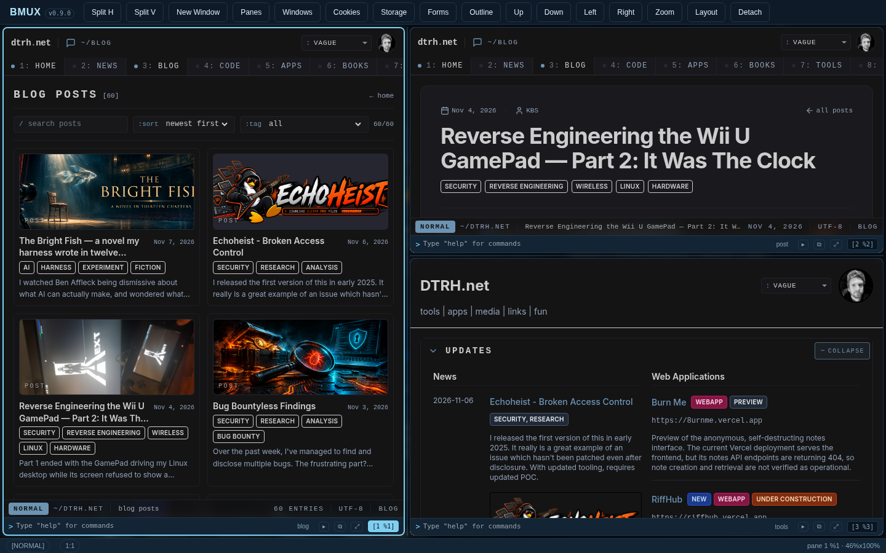

**`filter links` on the blog.** 343 anchors found and 200 boxed; the hovered one is
named in the pane's status line (`FILTER: links · 200 match(es)`) and the refine card
offers to narrow the result down — click a button, a digit, `y`/`n`, or type `yes`/`no`.

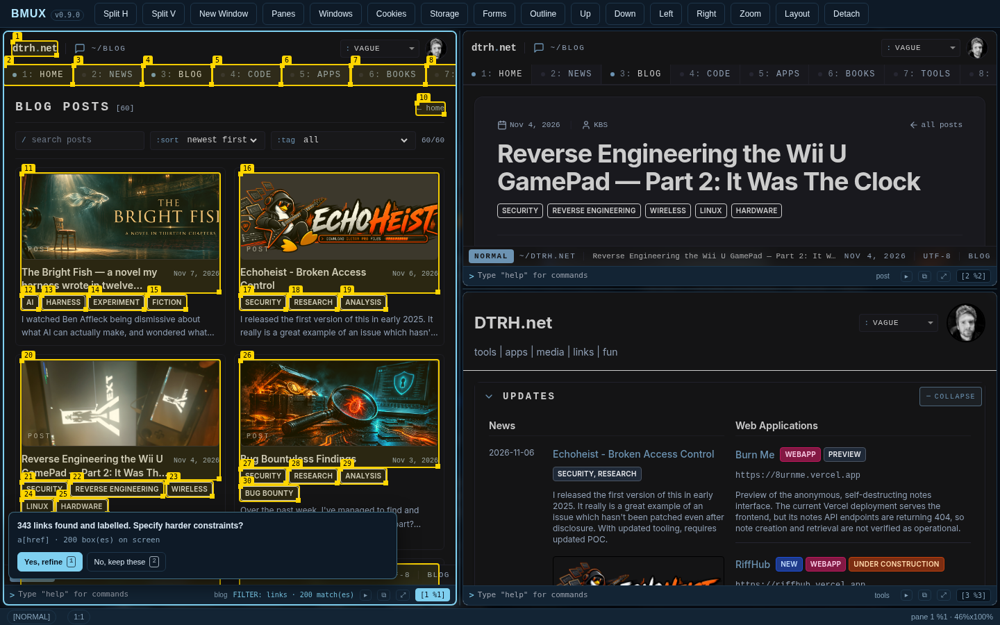

**Inspection on the same page.** `outline` prints the heading hierarchy and landmarks
and flags the level jumps, then `list-scripts --third-party` lists 139 scripts and
points at the only third-party tag — both answered by the pane's own frame.

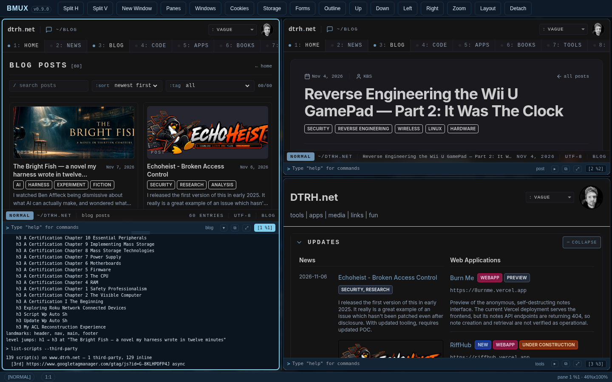

**The classic activation shot.** Three panes on `/tools` in the frost palette, from the
0.5.0-era set (kept: every later screenshot builds on it).

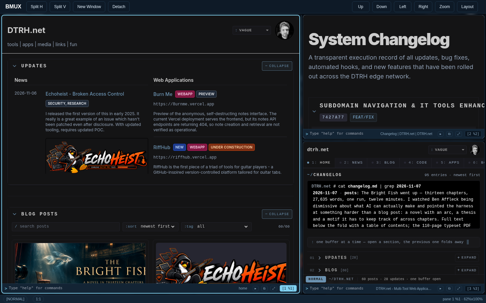

**`filter links` on the changelog pane.** Every match is boxed with a numbered tab;
the hovered one is named in the pane's status line
(`FILTER: links - A.shrink-0.font-mono.text-sm "dtrh.net" · 1/13`), and the refine
card offers to narrow the result down.

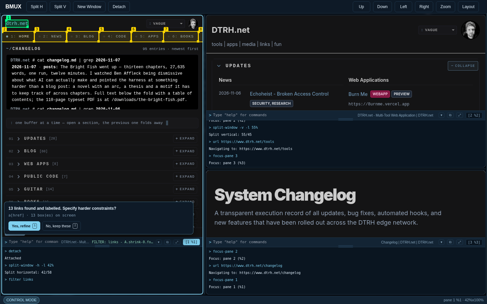

**A detached console.** `log detach` moves that pane's console — scrollback
included — into its own window: drag the header to move it, the corner to resize,
`⧉ dock` to put it back. The panes keep running underneath.

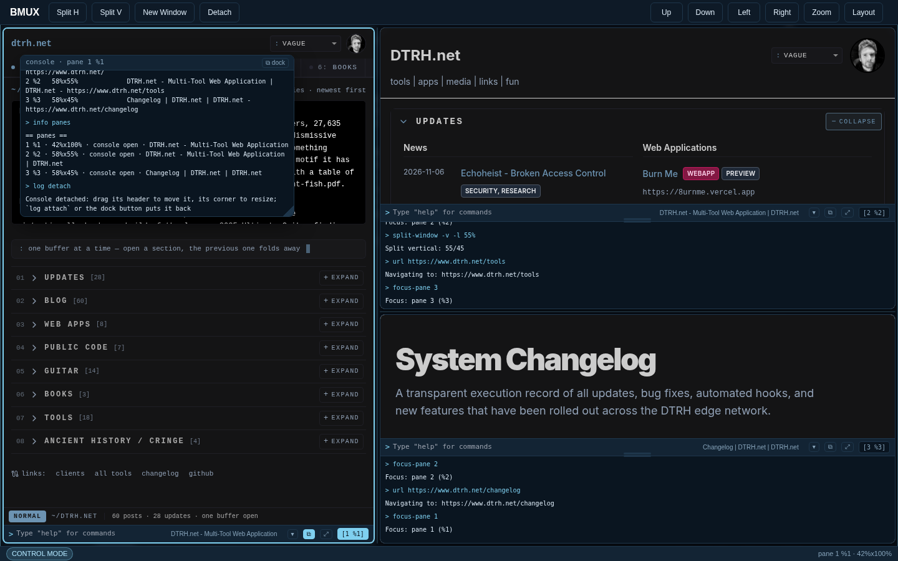

**The classic palette.** `theme classic` on the same layout (with the debug window
and the docked pane console open) — the original black/green terminal is one
command away, and `theme frost` brings the ice palette back.

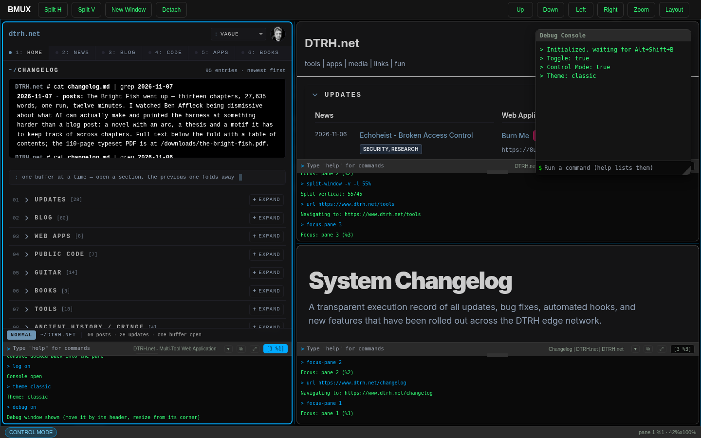

**A `.bmux` script, at its last step.** `examples/dtrh-tour.bmux` built its own three
panes — the home page on the left, `/changelog` on the right, `/tools` underneath —
then worked through layouts, filters, persistence and the palette, without
reloading anything. The panel at the bottom-left holds the script, its line count
and `finished · 63/63` (the tour has grown since — 80 commands today); the pane
footer shows the titles the script set.

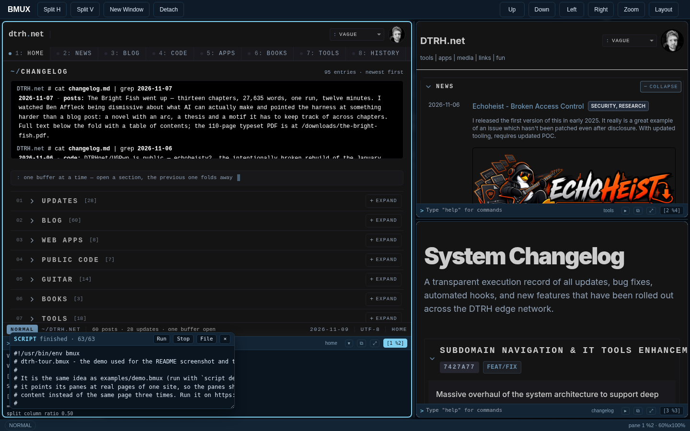

**Two windows in one tab.** The same pages, a second layout: `new-window docs`,
a split inside it, and `list-windows` printed into that pane's console (`1 1 · 3
pane(s)` / `2 docs · 2 pane(s) [ACTIVE]`). The window chip at the bottom reads
`2:docs (2/2)`; only the active window's panes are shown, and none of the five
pages reloaded to get here.

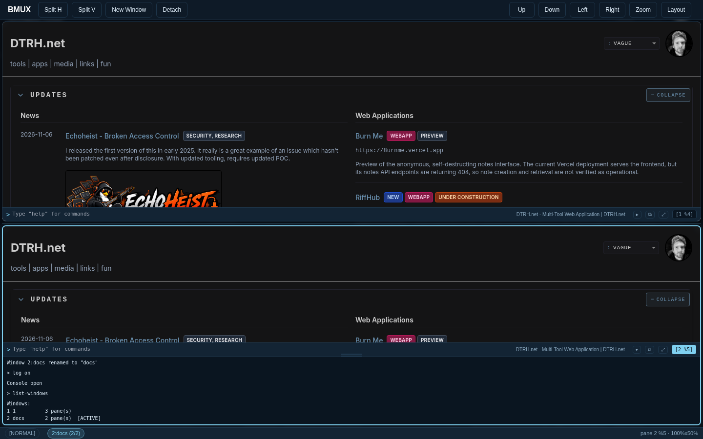

**Inspecting a pane.** `list-cookies` for the `/changelog` pane shows the site's
`_ga` cookies and ones BMUX just injected (`set-cookie bmux_demo=1`), with
`domain`, `path`, `expires`, `secure`, `httpOnly` and `sameSite` — then `outline`
prints the heading hierarchy of that same pane and flags that it jumps `h1 → h4`.
Both answers came from inside the pane's own frame.

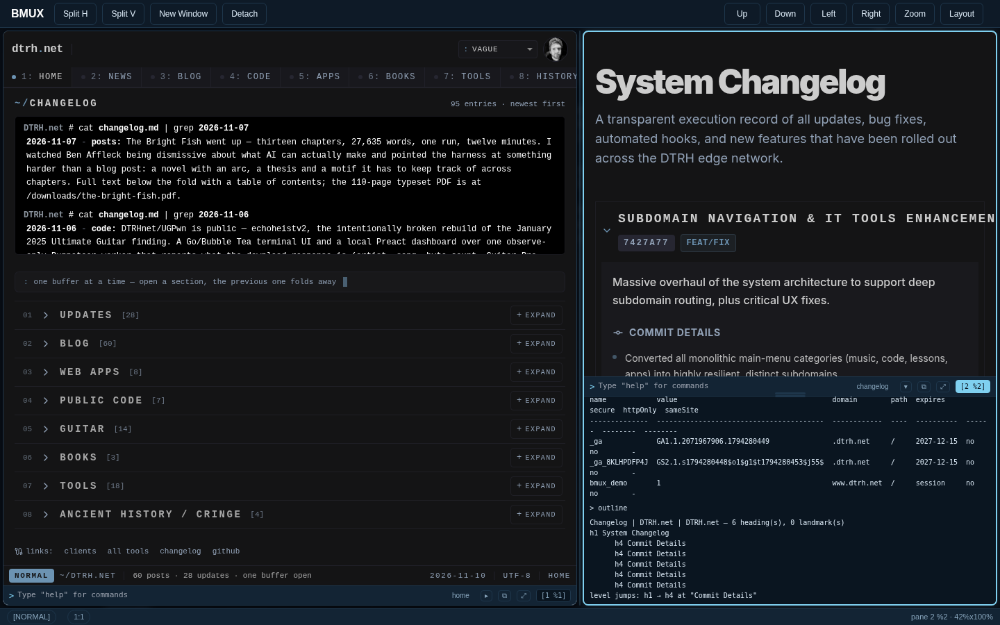

**A different palette.** `theme` lists the seven and marks the current one; the same
three-pane layout in `midnight` — indigo shell, violet accent — with the choice saved
with the layout. Frost is the default, and `theme next` cycles.

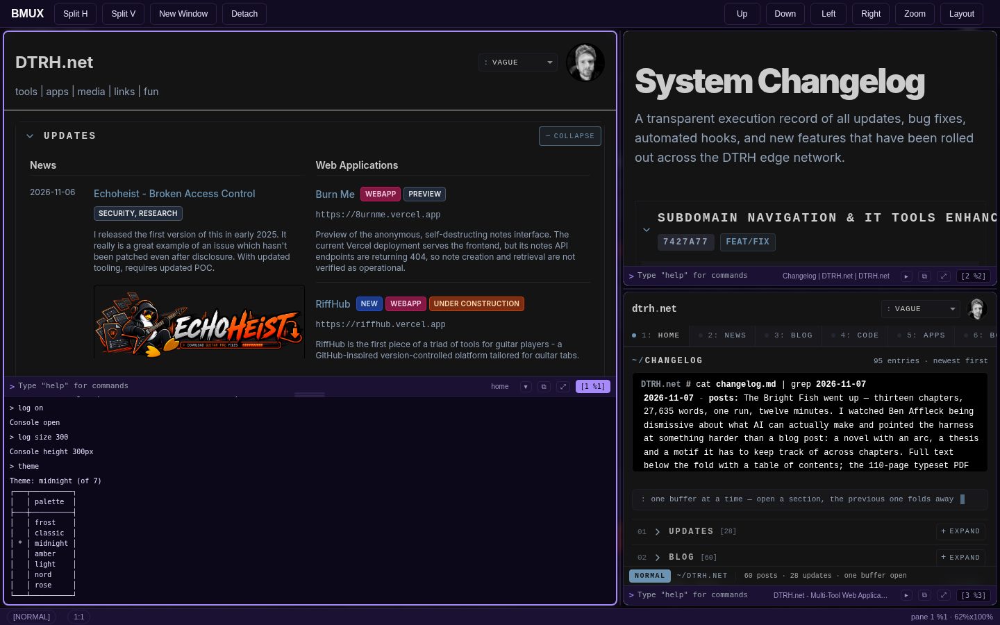

---

## Quick start

### Installation

1. **Clone or Download** this repository
2. **Open Chrome**: Navigate to `chrome://extensions`
3. **Enable Developer Mode** (top-right toggle)
4. **Load Unpacked**: Click and select the `BMUX` folder
5. **Refresh** any open tabs to activate

Every step of that, plus upgrade notes and the honest list of limits, is also in
**[RELEASE_1.0.0.md](RELEASE_1.0.0.md)**.

### Basic Usage

1. **Activate BMUX**: Press `Alt+Shift+B` or click the extension icon — either one
   turns it on (overlay + Control Mode, with a quiet blue ring). Press it again to
   turn it off.
2. **Split Horizontally**: Press `%` (Control Mode) or click `Split H`
3. **Split Vertically**: Press `"` (Shift+') or click `Split V`
4. **Resize**: drag the boundary between panes with the mouse, or press
   `Alt+←/→/↑/↓`
5. **Move focus**: click a pane, use the `Up` / `Down` / `Left` / `Right` toolbar
   buttons, or press an arrow key in Control Mode
6. **Zoom**: press `z` to make the focused pane fill the overlay, `z` again to
   return
7. **Exit Control Mode**: Press `Escape`
8. **Hide Overlay**: Press `d` or click "Detach"

---

## Features

### 🪟 Splitting with real sizes
- **Horizontal splits** (`%`) - Side-by-side panes
- **Vertical splits** (`"`) - Stacked panes
- **Percentage splits** - `split-window -l 30%` gives the class TMUX gives you:
  a sidebar, a main area, anything from 10% to 90%
- **Placement and focus flags** - `-b` puts the new pane first, `-d` keeps focus
  where it was
- **Unlimited nesting** - split any pane, any number of times

### 📐 Ratio-driven layout engine
- The layout is a **binary split tree** (`direction` + `ratio`), not a pile of
  CSS flex boxes. Every operation edits the tree and recomputes rectangles.
- Rectangles are **fractions of the overlay**, so resizing the browser window
  keeps every pane proportional.
- **Nothing is ever reparented.** Panes are absolutely positioned, so splitting,
  changing layout, swapping and rotating **do not reload the pages you are
  looking at** — which is impossible to get right while moving iframes around.

### 🖱️ Mouse-first resizing
- Grab the boundary between two panes and drag. Handles are 8 px wide with a
  hairline marker, a hover highlight and a proper `col-resize`/`row-resize`
  cursor.
- **Double-click a boundary** to reset that split to 50/50.
- A drag shield covers the overlay while you drag, so the pointer never slips
  onto an iframe and stalls the resize.
- **Click to focus**: click a pane's body, footer, or inside its iframe.

### 🔍 Zoom
- `resize-pane -Z` (or `z`) makes one pane fill the overlay.
- The other panes are **hidden, not destroyed** — their pages keep running,
  their scroll position and state intact.
- Marked in the status bar (`· ZOOM`) and in `list-panes` (`[ZOOM]`);
  any directional focus move unzooms first.

### 🧩 Layout presets
- `even-horizontal`, `even-vertical`, `main-vertical`, `main-horizontal`, `tiled`
- `select-layout <name>` or `next-layout` (`Space`) to cycle
- Presets rebuild the tree only, so no page reloads

### 🔀 Reordering
- `swap-pane <a> <b>` - two panes trade places
- `rotate-window` - every pane moves one slot along the layout
- Both keep the iframes exactly where they are in the DOM, so nothing reloads
- Windows rearrange the same way: switching a window is a show/hide, not a reload

### 🎯 Pane navigation
- **Four toolbar buttons** - `Up`, `Down`, `Left`, `Right`
- **Arrow keys** - in Control Mode, or after the `Ctrl+b` prefix
- **Wrap-around** - with two panes side by side and focus on the right one,
  `Right` moves to the left pane. No dead ends at the edge of a layout.
- **Geometric** - the nearest pane in that direction wins, with a penalty for
  drifting off-axis, so the pane straight ahead beats one off to the side.
- **`display-panes`** - shows each pane's number over it; press a digit to jump
  there (`q` in Control Mode)
- **`cycle-pane next|prev`** and **`last-pane`** (`o` and `;`)
- **Every move is logged** - e.g. `Focus right: pane 1/2 (wrapped)`

### 🧰 The extension menu: Toggle and Settings
Clicking the toolbar icon opens a small menu instead of toggling blind:

- **Toggle** shows or hides the overlay in the tab you are looking at (overlay *and*
  Control Mode, as always). `Alt+Shift+B` still does the same thing without the menu.
- **Settings** opens the toolbar editor in its own tab.

<p align="center">
  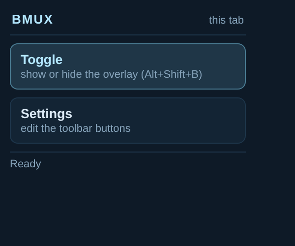
</p>

### 🎛️ A toolbar you can edit
The buttons along the top of the overlay are data, not markup: each is a `label` plus
a `command`, and every button runs its command through the same dispatcher as the
console. The settings page lists the current set, moves buttons up and down, deletes
them, and adds new ones from a live catalog of **every command the extension
registers** — so a button can only be saved if its command actually exists.

- **Built in**: `Split H`, `Split V`, `New Window`, `Panes`, `Windows`, `Cookies`,
  `Storage`, `Forms`, `Outline`, the four focus buttons, `Zoom`, `Layout`, `Detach`.
- The wordmark carries the extension version (`BMUX v1.0.0`, read from the manifest),
  so a bug report always has a number attached.
- **Add anything**: `list-cookies -j`, `outline`, `theme midnight`, `script demo`,
  `filter links --visible`, or a command of your own.
- The editor shows the usage of whatever you type, refuses an unknown command with the
  reason, and the renderer re-checks every entry before drawing it — a button whose
  command no longer exists is skipped with a log line, never a dead button.
- Stored in `chrome.storage.local` (this profile only, never synced); **Load defaults**
  puts the built-in set back.

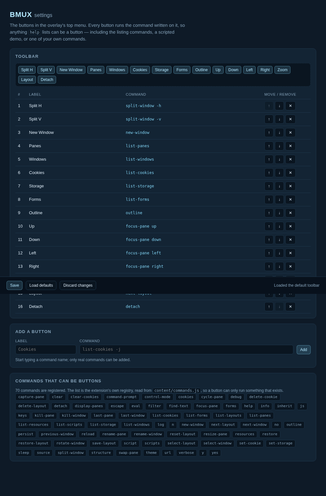

### 📖 Help that actually helps
`help` prints every command in box-drawn tables **grouped into categories** — Layout &
panes, Windows, Persistence, Scripts, Cookies, Storage, Inspection, Appearance,
Diagnostics, Overlay & input — each with its own sub-categories. `help <command>` is a
full page: usage, an arguments table (and what is required), a flags table, examples,
notes, what to read next, and where the full docs are.

```
> help split-window
split-window — overlay command

Split the active pane in two, keeping every page loaded

Usage
  split-window [-h|-v] [-l <size>] [-b] [-d]  (size like 30% or 0.3)

Flags
┌────────────┬─────────────────────────────────────────────────┐
│ flag       │ what it does                                    │
├────────────┼─────────────────────────────────────────────────┤
│ -h         │ split side by side (a new pane to the right)    │
│ -v         │ split top to bottom (a new pane below)          │
│ -l <size>  │ size of the new pane: 30%, 30 or 0.3 (10–90%)   │
…
Examples
  > split-window -v -l 30%
  > split-window -h -b -d

Notes
  - The new pane starts on the same URL as the pane it splits; no page is reloaded.
See also: kill-pane, resize-pane, select-layout

Full documentation: docs/COMMAND_USAGE.md
```

Narrow it however you think:

```
> help                 # every command, by category and sub-category
> help layout          # one category (sub-categories kept)
> help layout/focus    # one sub-category
> help overlay         # every overlay command
> help pane            # every pane command
> help list-cookies    # one command, in full
> help list            # search names and descriptions
> help cookies/        # a name that is both a command and a category
```

An unknown word gets a suggestion instead of a wall of text.

### 🔬 Looking inside a pane
Every pane is a different page, often a different origin. These commands ask the
pane's **own frame** what it contains, so they answer for pages BMUX otherwise
cannot inspect (a cross-origin iframe still runs a BMUX frame script):

```
> outline                      # heading hierarchy + landmarks (h1 … h3, level jumps)
> list-forms                   # action, method, every field: name, type, required
> list-scripts --third-party    # scripts, with [3rd] flagged and inline sizes
> list-resources               # images, css, fonts, xhr — counts and bytes per type
> find-text beta               # box every visible match, right there in the page
> list-storage                 # localStorage (or sessionStorage) keys and values
> set-storage injected=1       # write one; --remove deletes
> eval document.title          # run JS in the pane and print the result
> js "document.querySelectorAll('a').length"
```

- **Cookies live in the background**, behind the `cookies` permission: `list-cookies`
  shows `value`, `domain`, `path`, `expires`, `secure`, `httpOnly` and `sameSite`
  for the pane's origin, including cookies `document.cookie` can never see.
  `set-cookie name=value [--http-only] [--secure] [--expires 3600]` injects one,
  `delete-cookie <name>` removes one, `clear-cookies` empties the jar (after asking).
  `list-cookies --export netscape` prints a jar that `curl -b`, `wget --load-cookies`
  and `yt-dlp --cookies` accept; `-j` gives JSON.
- **`eval` runs in the page's own world** — real page globals, not a sandbox — via
  `chrome.scripting`, addressed by the frame id the pane reports for itself (see the
  screenshot above: `list-cookies` and `outline` in one pane console). Values
  print as a table or pretty JSON; MV3 forbids `eval` inside a content script, which
  is why it takes that route.
- **`find-text` boxes stay in the pane's own document**, so they work on
  cross-origin pages and survive BMUX redraws; `find-text --clear` removes them.
- Results print as aligned tables (`formatValue`), pipe into `-j` for JSON, and are
  ordinary command output — so a `.bmux` script can capture them with `sleep`.

### 🪟 Windows: several layouts in one tab
A browser tab no longer has one layout — it can have up to six, each with its own
panes, and switching between them is a DOM show/hide, so nothing reloads:

```
> new-window docs        # a second layout in this tab, one pane, this page
> split-window -v -l 45%  # arrange it however you like
> rename-window docs
> list-windows
Windows:
┌───┬──────┬───────┬────────┐
│ # │ name │ panes │        │
├───┼──────┼───────┼────────┤
│ 1 │ 1    │     3 │        │
│ 2 │ docs │     2 │ ACTIVE │
└───┴──────┴───────┴────────┘
> next-window            # or n, or click the chip in the status bar
> select-window 1        # by number, or by name: select-window docs
> kill-window            # asks first; the last window is refused
```

- **Keys**: `n` next, `p` previous, `c` new, `&` kill (with a confirmation card),
  `,` rename (a text prompt), `w` list — in Control Mode and after `Ctrl+b`.
- **The status bar chip** (`2:docs (2/3)`) names the current window and cycles to
  the next one on click, so the mouse path exists too.
- **Everything is per window**: tree and ratios, focused pane, zoom, pane consoles
  and titles. Pane numbers (`[1 %4]`, `display-panes`) start at 1 in each window;
  pane ids (`%1`, `%2`) stay unique across the tab.
- **Hidden windows keep running** — their iframes are `display:none`, not
  unloaded, which is why switching costs nothing. Six windows is the cap, and
  `.bmux` scripts drive them like any other command.
- **`reset-layout`** resets the window you are in (it used to be `new-window`,
  which now creates a window — the one breaking change in 0.7.0).

### 💾 Sessions that survive a reload
The layout of the tab you are in is saved as it changes and put back when the
page loads:

- **What comes back**: the split tree and its ratios, every pane's URL, custom
  titles, the focused pane, the maximized pane, and each pane console's open state
  and height.
- **Where it lives**: `chrome.storage.session`, keyed by tab id — survives a
  reload or navigation, dies with the browser, never synced.
- **The layout follows the page.** Because the snapshot belongs to the *tab* and
  not to the address, navigating somewhere else with the overlay on puts the new
  page in the root pane and leaves every other pane showing what it was showing —
  the old site is never dragged back. A plain reload restores everything, root
  pane included.
- **A new tab inherits the newest layout** (on by default): same splits, ratios,
  titles and console state, with the new tab's own page in the root pane.
  `inherit off` makes new tabs start as a single pane again.
- **Restored before the first pane is drawn**, so you never see an empty overlay
  flash.
- **Named layouts** go to `chrome.storage.local` and survive restarts:

```
> save-layout work        # 2 pane(s) saved for https://example.com
> restore-layout work     # back to those panes, titles and sizes
> list-layouts            # what is saved for this site
> delete-layout work      # or --all
> persist off             # stop saving this tab, and clear its snapshot
> persist status          # on/off, and where the current layout came from
> inherit status          # does a new tab inherit the newest layout?
> inherit off             # new tabs start with one pane again
```

- **Restoring recreates panes**, so the pages load fresh — scroll position and
  in-page state cannot be carried over. Inheritance copies the *shape*: the root
  pane is repointed at the new tab's own URL and the other panes keep their
  addresses.
- Snapshots are validated (version, tree shape, ratios, ≤ 12 panes, ≤ 32 deep,
  ≤ 64 KB) before they are stored or applied; a bad one is ignored, never partly
  restored.

### ⛓️ Chained commands
`;` runs commands one after another, from the console, the `:` line, a pane input
or a key binding:

```
> filter img; filter a          # box images and links together
> split-window -h; list-panes   # split, then show the result
```

- Segments run **awaited**, so a question raised by one is answered before the
  next starts.
- A failing segment does not stop the chain, and each gets its own echo.
- `\;` is a literal semicolon; a `;` inside quotes or `[] () {}` does not split,
  so `filter a[href="x;y"]` stays one command.

### 🎬 Scripted demos: `.bmux` files
A `.bmux` file is a list of commands, run in order with `sleep` between them — for
recording a demo, sharing a layout, or turning a sequence you keep typing into one
word:

```bmux
# examples/demo.bmux, in miniature
sleep 1
new-window
split-window -h -l 62%
rename-pane main
sleep 1.5
filter links -y
sleep 2
log detach
sleep 1.5
theme classic
```

```
> script demo            # run the built-in 73-command tour (about a minute)
> script file            # load a .bmux from disk into the panel
> script file --run      # load it and start at once
> script run             # run what is in the panel
> script stop            # stop after this command, or cut a sleep short
> script status          # panel state, line count, what the runner is doing
> sleep 2.5               # an ordinary command too: sleep 2.5; list-panes
```

- **The panel is the runner**: `Run`, `Stop`, `File` and `×`, `Ctrl+Enter` to run,
  and a progress line that always names the command being run
  (`7/87 · select-layout main-vertical`), tinted while a script runs.
- **Every step is echoed** into the debug console with its index and its result, so
  the transcript of a run is the transcript you would get typing it all yourself.
- **A failing line does not stop the rest** (`;`-chain semantics), and the run ends
  with `ran 87/87` or a count of the errors.
- **`sleep` is cancellable**: `script stop` ends a pending pause immediately and the
  next line never runs.
- **Not a programming language** by design — no variables, loops or branches, so
  every line is something you could type. A script also cannot click a prompt
  (use `-y`) or survive a reload: a navigation destroys the runner, so update
  steps like the persistence round trip stay manual.

Two examples ship: `examples/demo.bmux` (site-agnostic — what `script demo` runs)
and `examples/dtrh-tour.bmux` (the three-page dtrh.net tour in the screenshot
above). The format, the limits and a step-by-step walkthrough are in
**[docs/SCRIPTS.md](docs/SCRIPTS.md)**.

### 🔧 Debugging without a permanent window
The floating debug window is **optional and hidden by default** — the pane console
is the terminal now. When you want BMUX's own trace, either show the window or
mirror it into the pane you are looking at:

```
> debug on            # show the floating debug window (debug off / toggle)
> verbose on          # mirror debug output into the focused pane console
> info                # layout tree, panes, recent keys, runtime state
> info layout|panes|keys|state
```

### ❓ Prompts you can click
When a command needs an answer, a card appears above the pane's footer:

```
┌─ 23 links found and labelled. Specify harder constraints? ──┐
│ links (a[href]) · 23 box(es) on screen                      │
│ [ Yes, refine 1 ]  [ No, keep these 2 ]                     │
└─────────────────────────────────────────────────────────────┘
```

Click a button, press its digit, press `Enter` for the primary choice, use
`y`/`n` on yes/no cards, type `yes` / `no`, or `Esc` to cancel. It never steals
focus from a text field, and keys pressed with the focus inside the pane work too.
Prompt cards are a command-API feature (`api.ask` / `api.askText`), so any future
question uses the same UI.

### ⤢ Maximize any pane
Every pane footer has a `⤢` button: click it to maximize that pane (the on-screen
form of `Ctrl+b`, `Shift+z`), click `⤡` to restore. Clicking another pane's `⤢`
moves the maximize there. Keyboard (`z`, `Shift+z`), the toolbar `Zoom` button and
the pane buttons share one state.

### 🧊 Seven palettes, and a calmer Control Mode
Every terminal surface — toolbar, footers, consoles, panels, the status bar — draws
from one set of CSS variables, so a palette is a block of colour in
`content/styles.css` and nothing else. **Frost stays the default**; the rest are one
command away and the choice is saved with the layout:

| Palette | Look |
|---------|------|
| `frost` *(default)* | cold blues, ice text, one ice-cyan accent |
| `classic` | the original black terminal with green text |
| `midnight` | deep indigo shell, violet accent |
| `amber` | amber-on-brown CRT |
| `light` | paper and slate, for daylight reading |
| `nord` | arctic blue-grey |
| `rose` | deep plum with a sakura accent |

```
> theme              # list them, current one marked *
> theme midnight     # switch
> theme next         # cycle (theme prev goes back)
> theme frost        # the default
```

Control Mode is a one-pixel inset ring with a tinted `CONTROL MODE` chip rather than
a five-pixel blue frame around the page, in every palette.

### 💻 Per-pane console you can actually read
The console under each pane's input is a scrollback, not a flash message:

- Every command and its result is appended and kept (100 blocks), with a
  **scrollbar**.
- It **stays open** — the five-second auto-collapse is gone.
- A toggle button in the footer (`▸` / `▾`), the `l` key, or `log toggle` opens
  and closes it whenever you like.
- **Drag its top edge** to make it taller (up to 90% of the pane; double-click to
  reset; `log size 240` works too). The height and open state survive splits,
  layout changes and zoom.
- `clear` empties the scrollback.
- **Detachable**: `log detach` (or the `⧉` button in the footer) pulls the console
  out into its own window — drag the header to move it, the corner to resize,
  `⧉ dock` or `log attach` to put it back. The scrollback comes with it, and the
  detached console is saved with the layout.
- **Drag its top edge** (the two-line grip) to make it as tall as 90% of the pane;
  double-click the grip to reset it to 140px, or type `log size 320`.

**Line editing works like a shell** — in the pane console, the floating console and
the `:` line:

| Key | Effect |
|-----|--------|
| `Up` / `Down` | Recall previous commands (`Down` past the newest restores your draft) |
| `Tab` | Complete the command name, then its arguments (layouts, flags, presets, pane ids, directions…) |

An unambiguous `Tab` completes and adds a space; an ambiguous one fills in the
common prefix, and a second `Tab` lists the candidates. History is shared across all
inputs and keeps the last 200 commands.

### 🔎 Filter highlighting
`filter` inspects a same-origin pane and *shows* you what matched:

```
> filter .card
=== 2 match(es): ".card" ===

[1] DIV#alpha.card "Product card"
[2] DIV.card "Beta card"

Boxed 2 of 2 match(es). Hover one to name it in the pane status line; Esc or "filter -c" clears.
```

- Every match gets a **box** in the pane: 2px outline, light wash, and 7px corner
  ticks so a tiny or zero-height element is still visible, with a numbered tab.
- **Hover a match** and the pane's footer status line names it —
  `FILTER: .card - DIV#alpha.card "Product card" · 1/2` — and the box turns green.
  Move away and it falls back to `FILTER: .card · 2 match(es)`.
- **Live**: a MutationObserver re-queries and redraws when the page changes.
- **Preset words** expand into whole queries, with variants that need a real
  predicate rather than a selector:
  `filter links` · `filter links internal` · `filter links external` ·
  `filter images large` · `filter images noalt` · `filter headings` ·
  `filter text` · `filter text main` · `filter inputs` · `filter buttons` ·
  `filter tables rows` · `filter media video` · `filter prices` ·
  `filter comments` · `filter authors` · `filter dates` ·
  `filter articles headlines` · `filter forms` · `filter code` · `filter main`.
  `filter --presets` prints the vocabulary with the selector behind each word.
- **It draws first, then offers to narrow** when you use a preset or match more
  than 25 elements: `23 links found and labelled. Specify harder constraints?`
  → *Yes, refine* opens a card with **Inside a container…**, **Exclude a
  container…**, **Text contains…**, **Visible only**, **Unique targets**,
  **Keep these** and **Cancel**. Each round narrows the current set, re-labels the
  boxes and asks again (max 6 rounds).
- **The same narrowing without the questions**:
  `filter links --in main --text price --visible --unique href`
  (`--replace` starts a clean set, `-y` skips all prompts).
- `filter -l .card` lists without drawing, `filter -n 50 .card` caps the boxes
  (default 200), `filter -c` clears, `filter -y …` skips the questions.
- **Filters accumulate**: `filter img; filter a` boxes both; `--replace` starts
  over and `filter -c` clears everything.
- **`Esc` clears the boxes** — before it does anything else, from the top frame,
  from an input, or with the focus clicked inside the pane. A second `Esc` still
  leaves Control Mode.
- Nothing is injected around your page's elements: the boxes are sibling
  overlays in the pane document, so the page's layout is untouched.
- **Same-origin only** — a cross-origin pane cannot be measured or written into,
  and `filter` says so.

### 🏷️ Pane identity and titles
- **Numbers** - layout order (top-to-bottom, left-to-right), recomputed after
  every structural change so they always run 1..n
- **Ids** - `%1`, `%2`, … assigned once when a pane is created and never reused
- **Badge** - every pane footer shows `[number id]`, e.g. `[2 %2]`
- **Titles** - `rename-pane <title>`; otherwise the page `<title>` (same-origin)
  or the URL is used
- **`list-panes`** - number, id, size, active/zoom marker, title and URL, with
  `-j` for JSON

### 🎮 Dual control systems

#### Control Mode (Alt+Shift+B)
- **No prefix needed** - Direct keyboard commands
- **Visual indicator** - Blue border when active
- **Modal editing** - Like Vim's command mode

#### Legacy Mode (Ctrl+b)
- **TMUX-style prefix** - Classic two-key combos
- **Works everywhere** - Including input fields
- **Fallback option** - When hotkeys conflict

### 💻 Per-Pane Console
Every pane has a TMUX-style command input at the bottom:

```
> help              # List all commands
> source            # View HTML source in console
> filter div        # Find all div elements
> capture-pane      # Print the visible text
> url google.com    # Navigate to URL
> focus-pane 1      # Focus the pane numbered 1
```

### 🛠️ Extensible Commands
One registry defines every command — overlay and pane alike — in
`content/commands.js` (see [`docs/ADDING_COMMANDS.md`](docs/ADDING_COMMANDS.md)):

```javascript
'mycommand': {
    scope: 'pane',                      // 'overlay' or 'pane'
    description: 'What it does',
    usage: 'mycommand <arg>',
    execute: async function(api, args) {
        const pane = api.pane;          // api = { client, pane, log }
        // Your code here
        return 'Result message';
    }
}
```

### 🌐 CSP Header Removal
Loads sites that normally block iframes (GitHub, Google, Facebook, etc.)
- Uses Chrome's `declarativeNetRequest` API
- Only affects BMUX panes
- See [`docs/CSP_HANDLING.md`](docs/CSP_HANDLING.md) for details

### 🔒 Cross-Origin Safety
Graceful handling of cross-origin restrictions:
- Safe helper functions
- Clear error messages
- Fallback strategies
- See [`docs/CROSS_ORIGIN.md`](docs/CROSS_ORIGIN.md) for details

---

## Commands

Commands can be run from the toolbar, the debug console (`$` prompt), the `:`
line in Control Mode, or a pane's input (`>` prompt). One dispatcher runs them all:
`content/main.js` parses the line, looks it up in `content/commands.js` and calls
the command with an `api` object.

### Overlay Commands

These act on the whole overlay.

| Command | Description | Example |
|---------|-------------|---------|
| `help [command\|category\|overlay\|pane\|filter]` | Tables by category, or one command in full detail | `> help list-cookies` |
| `list-panes [-j]` | Number, id, size, marker, title, URL (`-j` = JSON) | `> list-panes` |
| `focus-pane <n\|%id\|dir>` | Focus by number, id, or direction (`up`/`down`/`left`/`right`, wraps) | `> focus-pane %2` |
| `last-pane` | Focus the pane that was active before | `> last-pane` |
| `cycle-pane [next\|prev]` | Focus the next or previous pane in layout order | `> cycle-pane prev` |
| `split-window [-h\|-v] [-l size] [-b] [-d]` | Split the active pane, optionally with a size | `> split-window -h -l 30%` |
| `kill-pane [n\|%id]` | Close a pane; the last pane is refused | `> kill-pane %2` |
| `resize-pane [-L\|-R\|-U\|-D n] [-x size] [-Z]` | Move the boundary, set the size, or zoom | `> resize-pane -R 5` |
| `select-layout <name>` | `even-horizontal`, `even-vertical`, `main-vertical`, `main-horizontal`, `tiled` | `> select-layout main-vertical` |
| `next-layout` | Cycle to the next layout preset | `> next-layout` |
| `swap-pane <a> [b]` | Swap two panes' positions | `> swap-pane 1 2` |
| `rotate-window [-r]` | Move every pane one slot along the layout | `> rotate-window` |
| `display-panes` | Show pane numbers; pick one with a digit | `> display-panes` |
| `new-window [name]` | Create a window (another layout in this tab) and switch to it | `> new-window docs` |
| `reset-layout` | Reset this window to one pane showing the current page | `> reset-layout` |
| `next-window [n]` / `previous-window [n]` | Switch window, wrapping at either end | `> next-window` |
| `last-window` | Back to the window you were in before | `> last-window` |
| `select-window <n\|name>` | Switch to a window by number or name | `> select-window docs` |
| `rename-window [name]` | Name this window; no name asks for one | `> rename-window docs` |
| `kill-window [n\|name]` | Close that window and its panes; the last one is refused | `> kill-window 2` |
| `list-windows [-j]` | Every window in this tab, with pane counts (`-j` = JSON) | `> list-windows` |
| `detach` | Hide or show the overlay | `> detach` |
| `control-mode [on\|off\|toggle]` | Turn Control Mode on, off, or toggle it | `> control-mode on` |
| `command-prompt` | Open the `:` command line | `> command-prompt` |
| `escape` | What `Esc` does: clear filter highlights, else leave Control Mode | `> escape` |
| `persist [on\|off\|status]` | Auto-restore for this tab; `off` also clears its snapshot | `> persist status` |
| `inherit [on\|off\|status]` | Whether a new tab starts from the newest layout (default on) | `> inherit off` |
| `script [run\|file\|demo\|open\|close\|stop\|status]` | Run a `.bmux` script: the panel, a file, or the built-in demo | `> script demo` |
| `sleep <seconds>` | Pause (`2`, `0.5`, `250ms`); paces scripts, works in chains | `> sleep 2; list-panes` |
| `keys` | Print the last key events and what they resolved to (shortcut diagnostics) | `> keys` |
| `info [section]` | Verbose diagnostics: `layout`, `panes`, `keys`, `state` | `> info panes` |
| `debug [on\|off\|toggle]` | Show or hide the floating debug window | `> debug on` |
| `verbose [on\|off\|status]` | Mirror debug output into the focused pane console | `> verbose on` |
| `theme [name\|next]` | Switch palette: frost, classic, midnight, amber, light, nord, rose | `> theme midnight` |
| `save-layout [name]` | Save the layout for this site (survives restarts) | `> save-layout work` |
| `restore-layout <name>` | Apply a saved layout | `> restore-layout work` |
| `list-layouts` | Saved layouts for this site | `> list-layouts` |
| `delete-layout <name\|--all>` | Remove saved layouts | `> delete-layout work` |
| `yes` / `no` | Answer the open prompt (`y` / `n` are aliases) | `> yes` |

### Pane Commands

These act on one pane — the pane whose input you typed into, or the active pane
for the console and `:` line.

| Command | Description | Example |
|---------|-------------|---------|
| `source` | View HTML source (transforms pane) | `> source` |
| `restore` | Return from console to browser view | `> restore` |
| `filter <selector> [-n max] [-y] [--in s] [--not-in s] [--text w] [--visible] [--unique] [--replace]` | Box matches, name them on hover, narrow them | `> filter links --in main` |
| `filter <preset> [variant]` | Preset query, e.g. `links internal`, `images large` | `> filter links internal` |
| `filter --presets` | List the preset vocabulary | `> filter --presets` |
| `filter -l <selector>` | List matches without drawing | `> filter -l a` |
| `filter -c` | Clear the highlight boxes | `> filter -c` |
| `capture-pane [-n lines]` | Print the pane's visible text (same-origin) | `> capture-pane -n 20` |
| `rename-pane <title\|->` | Title shown in the pane footer; `-` clears it | `> rename-pane Docs` |
| `url [new-url]` | Show or change pane URL | `> url github.com` |
| `reload` | Reload the pane | `> reload` |
| `log [toggle\|on\|off\|clear\|size px\|detach\|attach]` | Show, hide, resize, clear, or float this pane's console | `> log detach` |
| `list-cookies [filters] [-j] [--export netscape\|json]` | Cookies this pane would send, `httpOnly` included (`cookies` is an alias) | `> list-cookies --export netscape` |
| `set-cookie <name>=<value> [flags]` | Set a cookie for this pane's origin (`--http-only`, `--secure`, `--path`, `--domain`, `--expires`, `--same-site`) | `> set-cookie session=abc --http-only` |
| `delete-cookie <name>` | Remove one cookie | `> delete-cookie session` |
| `clear-cookies [-y]` | Remove every cookie for this pane (asks first) | `> clear-cookies` |
| `list-storage [local\|session] [pattern] [-j] [--keys]` | localStorage / sessionStorage of this pane | `> list-storage session` |
| `set-storage <key>=<value> [session]` | Write a storage item (`<key> --remove` deletes) | `> set-storage token=abc` |
| `list-forms [-j] [--highlight]` | Forms: action, method, every field (`forms` is an alias) | `> list-forms` |
| `list-scripts [-j] [--third-party]` | Scripts with third-party flags and inline sizes (`scripts` is an alias) | `> list-scripts --third-party` |
| `list-resources [-j]` | Images, stylesheets, fonts, xhr — counts and bytes (`resources` is an alias) | `> list-resources` |
| `eval <expression>` | Run JS in the pane and print the result (`js` is an alias) | `> eval document.title` |
| `find-text <query> [--no-highlight] [--clear]` | Search the visible text and box the matches | `> find-text beta` |
| `outline [-j]` | Heading hierarchy and landmarks (`structure` is an alias) | `> outline` |
| `clear` | Empty the pane console scrollback | `> clear` |

Bad input never throws: an unknown command, an unknown pane, a missing argument,
an unknown flag or an out-of-range size returns a message and leaves the layout
and focus where they were. `constructor`, `__proto__` and similar names are
rejected as unknown commands.

### `list-panes` output

```
> list-panes
Panes:
┌───┬────┬──────────┬────────┬────────┬──────────────────────────┐
│ # │ id │ size     │ state  │ title  │ url                      │
├───┼────┼──────────┼────────┼────────┼──────────────────────────┤
│ 1 │ %1 │ 50%x100% │ ACTIVE │ Docs   │ https://example.com/docs │
│ 2 │ %2 │ 50%x100% │        │ GitHub │ https://github.com/      │
└───┴────┴──────────┴────────┴────────┴──────────────────────────┘
```

`-j` prints the same data as JSON with fractional geometry, which is handy for
scripting:

```
> list-panes -j
[
  { "number": 1, "id": "%1", "title": "Docs", "active": true, "zoomed": false,
    "size": { "x": 0, "y": 0, "w": 0.5, "h": 1 }, "url": "https://example.com/docs" }
]
```

### Keyboard Shortcuts

| Key | Action in Control Mode |
|-----|------------------------|
| `Alt+Shift+B` | Toggle Control Mode |
| `%` | `split-window -h` |
| `"` | `split-window -v` (Shift+') |
| `c` | `new-window` (create a window) |
| `n` / `p` | `next-window` / `previous-window` |
| `&` / `,` | `kill-window` (confirms) / `rename-window` (asks) |
| `w` | `list-windows` |
| `d` | `detach` (hide overlay) |
| `x` | `kill-pane` |
| `←` `→` `↑` `↓` | Move focus, with wrap-around |
| `Alt+←/→/↑/↓` | Resize (move the boundary) |
| `z` / `Shift+z` | `resize-pane -Z` (zoom toggle — the tmux `prefix + Z`) |
| `q` | `display-panes` (press a number to jump) |
| `o` / `;` | `cycle-pane next` / `last-pane` |
| `l` | `log toggle` (open/close this pane's console) |
| `Space` | `next-layout` |
| `:` | `command-prompt` |
| `Esc` | `escape`: clear filter highlights if any, else leave Control Mode |

`%`, `Shift+5` and `5` all split horizontally (`"`, `Shift+'` and `'` vertically) —
the tables carry layout-independent aliases, because keyboards disagree about which
character a shifted digit or quote reports. `Ctrl+b` also works *inside* Control
Mode, so mixing the two is safe. If a shortcut does not fire, run `keys`: it lists
the last dozen key events with their raw `key`, `code` and modifiers, and the command
each one resolved to.

**Legacy (Ctrl+b prefix)** — the same command set, after `Ctrl+b`:

1. Press `Ctrl+b`
2. Release both keys
3. Press the command key (`%`, `"`, `c`, `d`, `x`, `:`, an arrow key, `Alt+arrow`, …)

Both key tables live in `BMUX_KEYBINDINGS` in `content/commands.js`; each entry is
a command line, so keys are not a second code path.

### Mouse

| Action | Result |
|--------|--------|
| Click a pane body or footer | Focus that pane |
| Click inside a pane's iframe | Focus that pane (cross-origin safe) |
| Drag a boundary between panes | Resize the split |
| Double-click a boundary | Reset that split to 50/50 |
| Drag a pane console's top edge | Resize that console (double-click resets it) |
| Drag the debug console's corner | Resize the floating console |
| Click a pane's `⤢` / `⤡` button | Maximize / restore that pane |
| Click a pane's `⧉` button | Detach that console into its own window (or dock it) |
| Drag a detached console's header | Move that window |

---

## How the layout works

```
        split(row, 0.3)
        /            \
   leaf(%1)      split(column, 0.55)
                  /              \
             leaf(%2)          leaf(%3)
```

- A leaf holds a pane element; a split holds a direction (`row` = side by side,
  `column` = stacked) and the share given to its first child.
- Rendering walks the tree once with the overlay's rectangle, which yields each
  pane's rectangle as fractions.
- `split-window`, `kill-pane`, `resize-pane`, zoom, `select-layout`, `swap-pane`
  and `rotate-window` only edit the tree; the panes stay where they are in the
  DOM. That is why pages keep running.

---

## Documentation

### Start here
- **[Quick reference](QUICKSTART.md)** - every key, command and gesture on one page
- **[Command usage guide](docs/COMMAND_USAGE.md)** - every command, every entry point, mouse, layouts, persistence, inspection
- **[Release notes](RELEASE_NOTES.md)** - what each version added, and the [1.0.0 release](RELEASE_1.0.0.md)
- **[Changelog](CHANGELOG.md)** - the detailed, per-version record

### Going deeper
- **[Scripts](docs/SCRIPTS.md)** - the `.bmux` format: `sleep`, the panel, writing and recording a demo
- **[Implementation overview](docs/IMPLEMENTATION.md)** - architecture, layout engine, message flow, every mechanism
- **[Adding commands](docs/ADDING_COMMANDS.md)** - the registry, the help metadata, making a command script-friendly
- **[Cross-origin handling](docs/CROSS_ORIGIN.md)** - what works across origins and why
- **[CSP handling](docs/CSP_HANDLING.md)** - how iframe blocking is bypassed
- **[Contributing](CONTRIBUTING.md)** - how to get involved, and what makes a good pull request

### Historical
- **[Design documentation](docs/DESIGN.md)** - the original design specification (pre-0.1.0)
- **[Update status](docs/UPDATE_STATUS.md)** - the 0.0.1 progress tracker

---

## Project structure

```
BMUX/
├── manifest.json           # Extension configuration (v1.0.0)
├── rules.json              # CSP header removal rules
├── CONTRIBUTING.md         # How to contribute, and what a good PR looks like
├── RELEASE_1.0.0.md        # The 1.0.0 release document
├── RELEASE_NOTES.md        # Release notes, newest first
├── CHANGELOG.md            # The detailed, per-version record
├── QUICKSTART.md           # One page: keys, commands, gestures
├── background/
│   └── main.js            # Service worker (state, message relay)
├── content/
│   ├── main.js            # Overlay DOM, layout engine, focus, dispatcher, script runner
│   ├── inspect.js         # Frame-side inspection: storage, DOM inventory, eval id
│   ├── commands.js        # Command registry + key bindings (source of truth)
│   ├── scripts.js         # .bmux format: parser, sleep arguments, built-in demo
│   └── styles.css         # Frost palette, split handles, panels, drag shield
├── popup/                 # The extension menu: Toggle + Settings
│   ├── popup.html
│   ├── popup.css
│   └── popup.js
├── settings/              # Toolbar editor (loads the registry to validate commands)
│   ├── settings.html
│   ├── settings.css
│   └── settings.js
├── examples/
│   ├── demo.bmux          # The shipped demo script (script demo runs this)
│   └── dtrh-tour.bmux     # The three-page tour used for the screenshots
└── docs/                  # Documentation
    ├── images/              # Screenshots used by this README
    ├── ADDING_COMMANDS.md
    ├── COMMAND_USAGE.md
    ├── SCRIPTS.md           # The .bmux format, limits and demo walkthrough
    ├── CROSS_ORIGIN.md
    ├── CSP_HANDLING.md
    ├── DESIGN.md
    ├── IMPLEMENTATION.md
    └── UPDATE_STATUS.md
```

`content/commands.js` is the single source of truth for commands. `content/main.js`
owns the DOM and the layout, and holds no command definitions, help text or
key-to-action switch.

---

## Design philosophy

### Not a Direct TMUX Clone
BMUX is **inspired by** TMUX but adapted for the browser:

- ✅ Familiar keyboard shortcuts
- ✅ Pane splitting, resizing, zooming, layout presets
- ✅ Command-line interface with a scriptable registry
- ✅ Things a terminal cannot do: mouse-draggable boundaries, live pages that
  survive re-layouting, per-pane inspection of real DOM
- ❌ Not a 1:1 terminal emulator
- ❌ No server, sessions or attached clients

### Modern Browser Experience
- **Glassmorphism UI** - Semi-transparent, blurred backdrop
- **Draggable debug console** - Move it out of the way
- **Per-pane footers** - Title, command input and a `[number id]` badge
- **Visual feedback** - Blue borders, resize handles, zoom markers, focus logs

---

## Privacy & security

### What BMUX Does
- ✅ Removes CSP/X-Frame-Options headers for panes
- ✅ Brokers cookies for the pane you ask about, through the `cookies` permission
- ✅ Stores state locally in browser
- ✅ Open source - fully auditable code

### What BMUX Stores Locally
- The layouts of each tab — every window, its split tree, pane URLs, custom
  titles, focus, zoom and console state — in `chrome.storage.session`, cleared
  when the browser closes.
- Named layouts you explicitly saved, per site origin, in `chrome.storage.local`.
- The auto-restore switch, and whether a new tab inherits the newest layout.
- **Never `sync`**, never uploaded. `persist off` clears the current tab's
  snapshot; `delete-layout --all` removes a site's named layouts. Both are
  plaintext in your own browser profile, like history.

### What BMUX Does With Cookies
- Only when you run `list-cookies`, `set-cookie`, `delete-cookie` or `clear-cookies` —
  there is no background harvesting, no periodic sync and no upload.
- The jar is read for the URL of the pane you name, and printed to the console (or
  exported to the clipboard as a file). Nothing is stored by BMUX itself.

### What BMUX Does NOT Do
- ❌ Track your browsing
- ❌ Send data over network
- ❌ Inject ads or modify content
- ❌ Access sites you don't explicitly load

### Activation
Clicking the toolbar icon or pressing `Alt+Shift+B` turns BMUX on — overlay plus
Control Mode in one step, and the menu's **Toggle** turns it off the same way. If your
window manager or another extension has taken
`Alt+Shift+B`, rebind it at `chrome://extensions/shortcuts`; `Ctrl+b` works
regardless.

### Permissions Explained
- **`declarativeNetRequest`** - Remove iframe-blocking headers
- **`<all_urls>`** - Apply rules to any site you load
- **`tabs`** - Know which tab a layout belongs to (and relay keys from panes)
- **`storage`** - Save layouts (`session` for the tab, `local` for named ones)

See [`docs/CSP_HANDLING.md`](docs/CSP_HANDLING.md) for full security details.

---

## Known limitations

### Browser Restrictions
- **Some sites** may use JavaScript iframe busters (can't be bypassed)
- **Cookie restrictions** may affect third-party content
- **Same limitations** as browser DevTools iframes

### Current Version (1.0.0)
- ⏳ **Restored panes load fresh** - a page cannot be cloned live, so scroll
  position, form input and in-page state are lost on restore
- ⏳ **Not persisted**: prompts, filter boxes, focus history and console
  scrollback (transient UI); console open/height *is* persisted
- ⏳ **A new tab inherits the newest layout from another tab**, so it copies the
  shape (fresh pages), not the live pages; only one layout is offered
- ⏳ **Extension reload/update clears `storage.session`**, so the tab layout is
  lost (named layouts remain)
- ⏳ **`Alt+Shift+B` can be taken** by the window manager or another extension;
  rebind it at `chrome://extensions/shortcuts` and use `keys` to see what arrived
- ⏳ **A `.bmux` script cannot click or survive navigation** - prompts need `-y`,
  and a reload/new tab ends the run (those steps stay manual)
- ⏳ **Scripts have no variables, loops or branches** by design — a script is a
  list of commands you could have typed, not code
- ⏳ **Windows are capped at six per tab**, and a hidden window keeps its iframes
  running (that is why switching is instant, and why the cap exists)
- ⏳ **`new-window` changed meaning in 0.7.0** - it creates a window; `reset-layout`
  is the old reset (a `.bmux` script written for 0.6.0 needs that one-word edit)
- ⏳ **No floating panes** - every pane takes layout space
- ⏳ **No `break-pane` / `join-pane`**
- ⏳ **No broadcasting** of input to several panes
- ⏳ **Mouse only** - resizing needs a pointer; touch is not handled
- ⏳ **`source`, `filter` and `capture-pane` need a same-origin pane** — they read the
  pane's document from the top frame. The inspection commands (`list-storage`,
  `forms`, `scripts`, `resources`, `outline`, `find-text`, `eval`) and the cookie
  commands work on **cross-origin** panes, because they ask the pane's own frame or
  the background
- ⏳ **`eval` is subject to the page's CSP**: MV3 forbids eval in a content script, so
  BMUX runs it through `chrome.scripting` in the frame's main world — a page that
  keeps a CSP (`<meta>`) and disallows `unsafe-eval` will refuse the expression, and
  the command says so
- ⏳ **The `cookies` permission** is why `httpOnly` cookies can be listed and cleared;
  the extension declares it explicitly, and it is used only for the pane you ask
  about
- ⏳ **Filter boxes are measured when drawn** — a page that moves elements without
  mutating the DOM (CSS transitions) needs the filter re-run
- ⏳ **A yes/no prompt times out after 15s** (cancelled, boxes stay); text
  prompts wait indefinitely
- ⏳ **Refining narrows what is drawn**, but a page mutation re-queries the
  selectors, so the boxes can re-broaden after a refinement
- ⏳ **Chained filters keep appending** until `filter -c` or `--replace`
- ⏳ **Presets depend on the page's markup** — `prices`/`comments` need
  conventional class names, so plain selectors are the fallback
- ⏳ `kill-pane` refuses the last pane (use `reset-layout` to start the window over)

---

## Roadmap

### Version 0.1.0
- [x] Ratio-driven layout engine; no page reloads on split or re-layout
- [x] Percentage splits, `-b` / `-d`
- [x] Real `kill-pane`
- [x] Mouse-draggable split boundaries, double-click reset
- [x] Zoom
- [x] Layout presets (even / main / tiled) and `next-layout`
- [x] Pane titles, `list-panes --json`, `capture-pane`
- [x] `swap-pane`, `rotate-window`, `display-panes`, `cycle-pane`, `last-pane`
- [x] One command registry shared by buttons, console, `:` line, pane inputs and keys

### Version 0.2.0
- [x] `filter` boxes every match in the pane, with numbered corner marks
- [x] Hover names the matched element in the pane status line
- [x] Live re-query when the page changes under the boxes
- [x] `Esc` / `filter -c` to clear, from the top frame and from inside the pane
- [x] `filter -l` (list only) and `filter -n <max>` (box cap)

### Version 0.3.0
- [x] Pane console: persistent scrollback, toggle button, drag resize, `log` command
- [x] Filter presets (`links internal`, `images large`, …) with `--presets`
- [x] Yes/no confirmation before boxing a preset or a large result
- [x] `Shift+z` zoom toggle (tmux `prefix + Z`)
- [x] Resizable floating debug console

### Version 0.4.0
- [x] `;` command chaining, awaited, from every entry point
- [x] Clickable prompt cards (`api.ask` / `api.askText`) with digit/`y`/`n`/`Esc` parity
- [x] Per-pane `⤢` maximize button synced with `Shift+z`
- [x] Filter refinement rounds (`--in`, `--not-in`, `--text`, `--visible`, `--unique`)
- [x] Filters accumulate across commands (`--replace` to reset)

### Version 0.5.0
- [x] Per-tab layout restore (split tree, ratios, URLs, titles, focus, zoom, consoles)
- [x] Named layouts in `chrome.storage.local` (`save-layout` / `restore-layout` / `list-layouts` / `delete-layout`)
- [x] `persist [on|off|status]` off switch that also clears the snapshot
- [x] Layout follows the page on navigation; new tabs inherit the newest layout (`inherit`)
- [x] Snapshot validation (version, tree shape, ratios, ≤ 12 panes, ≤ 32 deep, ≤ 64 KB)
- [x] Background owns persistence, tab-close cleanup and startup pruning

### Version 0.6.0
- [x] `.bmux` script files: `script run` / `script file` / `script demo`, one command per line
- [x] `sleep <seconds>` (`0.5`, `250ms`) — awaited, cancellable pacing for demos
- [x] The script panel: Run / Stop / File / `Ctrl+Enter`, live `7/73 · command` progress
- [x] Scripts echo every step with its index; a failing line does not stop the run
- [x] `script stop` cuts a pending `sleep` short; nested runs refused
- [x] Shipped demo (`examples/demo.bmux`), byte-identical to what `script demo` runs

### Version 0.7.0
- [x] Windows: several named layouts in one tab, each with its own tree/focus/zoom/consoles
- [x] `new-window [name]`, `next-window`, `previous-window`, `last-window`, `select-window`
- [x] `rename-window` (with a text prompt), `kill-window` (with a confirmation), `list-windows [-j]`
- [x] `reset-layout` — the old `new-window` behaviour, now per window
- [x] Status-bar window chip (click = next), keys `n` `p` `c` `&` `,` `w`
- [x] Snapshot v2: every window persisted, version-1 layouts upgraded on read
- [x] Switching windows never reloads a page (verified with a page-load counter)

### Version 0.8.0
- [x] `list-cookies` / `set-cookie` / `delete-cookie` / `clear-cookies`, with `-j` and Netscape export
- [x] `list-storage` / `set-storage` for `localStorage` and `sessionStorage`
- [x] `list-forms`, `list-scripts` (third-party flagged), `list-resources`
- [x] `eval` / `js`, `find-text` (boxes drawn in the pane), `outline` / `structure`
- [x] A frame-side inspection relay, so the above work on cross-origin panes
- [x] Background cookie broker: `httpOnly` visibility, inject and delete

### Version 1.0.0
- [x] Extension menu: **Toggle** and **Settings** (a real popup, frost-styled)
- [x] Toolbar buttons are data (`label` + `command`), editable in a settings page
- [x] Add/remove/reorder buttons, verified against the command registry, capped at 24
- [x] `help` in box-drawn tables; `help <command>` with arguments, flags, examples, notes
- [x] `help <filter>` search over names and descriptions
- [x] `help` grouped by category and sub-category; `help <category>`, `help <category>/<sub>`,
      `help overlay`, `help pane`
- [x] The extension version in the top menu (and in the menu popup)
- [x] The overlay re-checks every configured button and skips commands it does not know

### Version 0.10.0
- [ ] Floating panes (overlay a pane without taking layout space)
- [ ] `break-pane` / `join-pane`
- [ ] Broadcasting input to all panes
- [ ] Pane drag-and-drop reordering
- [ ] Touch/pointer-based resizing

### Future
- [ ] Firefox compatibility
- [ ] Custom themes
- [ ] Plugin system
- [ ] Cloud sync (optional)

---

## Contributing

Bug reports, ideas, documentation fixes and pull requests are welcome — the full
expectations are in **[CONTRIBUTING.md](CONTRIBUTING.md)**. In short: keep a pull
request focused, explain the problem before the diff, include how you tested it, and
update the docs that your change makes stale.

Areas where help is especially useful:

1. **Testing** - try it on different sites and browsers, report what breaks
2. **Commands** - write one ([guide](docs/ADDING_COMMANDS.md)); it shows up in `help`
   and in the toolbar editor automatically
3. **Documentation** - the guides, the examples, the screenshots
4. **Design** - UI/UX, palettes, accessibility
5. **Code** - bug fixes, regressions, performance

---

## License

MIT License - See LICENSE file for details

---

## Acknowledgments

- **The tmux project and its maintainers** — thank you. BMUX exists because tmux got
  the model right: a split tree, panes that keep running, one key to move, one command
  line to rule them all. BMUX borrows its layout, its command names (`split-window`,
  `kill-pane`, `display-panes`, `new-window`, `prefix + Z` …) and its manners on
  purpose, so that time spent in tmux pays off here. It is not tmux and does not try to
  replace it; it is a thank-you note with a browser attached.
  [github.com/tmux/tmux](https://github.com/tmux/tmux)
- **The terminal-tooling community** — `fzf`, `reptyr`, the TUI libraries and everyone
  who writes about their setup: the workflows in [Why BMUX?](#why-bmux) come straight
  from that tradition.
- **Chrome extensions platform** — `declarativeNetRequest`, `chrome.scripting`,
  `chrome.storage`, `chrome.cookies`: the APIs that make panes, persistence and
  inspection possible without a native helper.
- **Everyone who reported a bug, asked for a command or sent a fix.**

---

## Support

- **Issues**: [GitHub Issues](https://github.com/dtrhnet/BMUX/issues)
- **Discussions**: [GitHub Discussions](https://github.com/dtrhnet/BMUX/discussions)

---

**Made with ❤️ for productivity enthusiasts who miss TMUX when browsing**

Version 1.0.0 · Last updated November 2026
